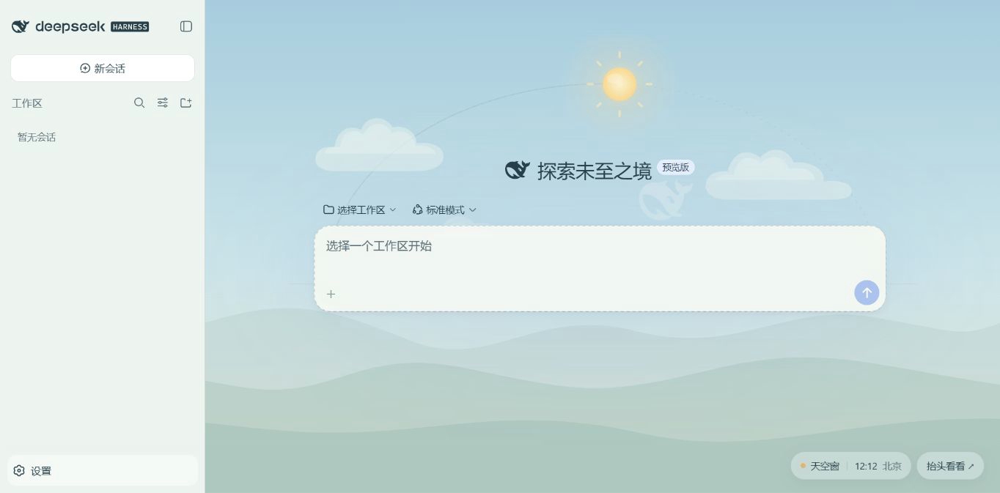
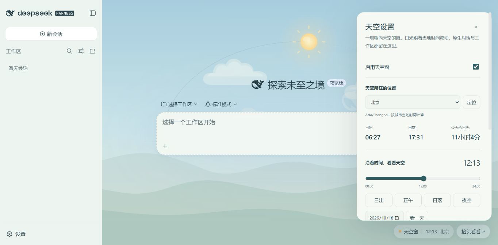
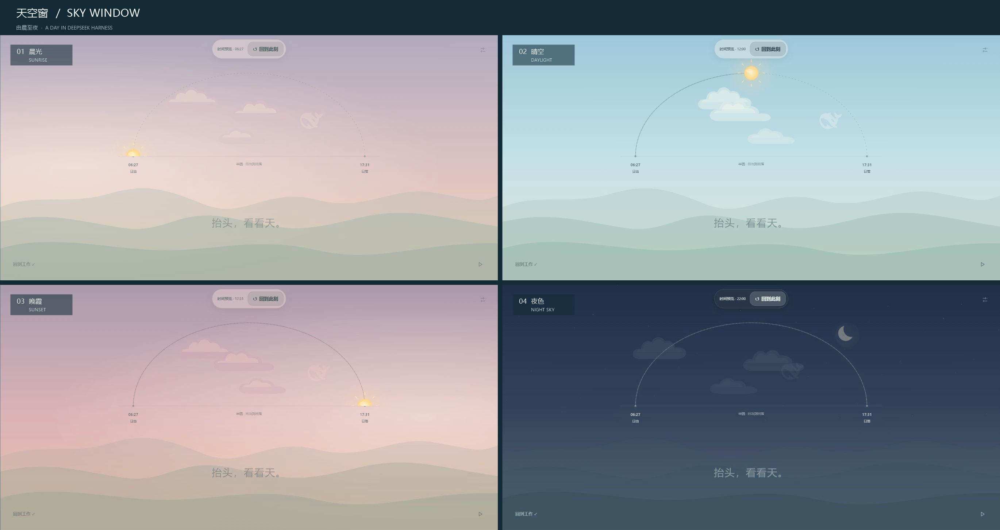
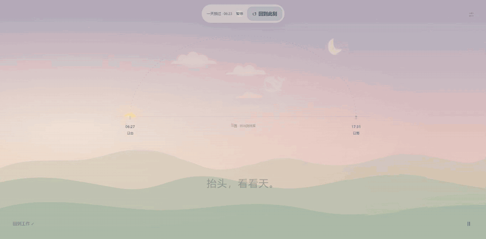

# DSH Sky Window

[简体中文](./README.md) · [English](./README.en.md)

A living sky for people who spend their day working at a screen.

Sky Window is a theme plugin for the real DeepSeek Harness (DSH) workspace. The sun follows a semicircular path based on local time. The sky moves from sunrise through daylight and sunset to moonlight and stars, while clouds and a subtle DeepSeek logo cloud drift past.

**A sky behind your work.** Keep using the native workspace, conversations, and composer.

[](./dsh-sky-window/docs/images/02-workspace-skin.png)

**Make the window yours.** Choose a city, preview sunrise and sunset, and adjust sky intensity and cloud motion.

[](./dsh-sky-window/docs/images/03-sky-settings.png)

Both screenshots use the original PNG files. Click either image to view its original size.





## Already using DSH? Install the plugin

Install by package name from [npm](https://www.npmjs.com/package/dsh-sky-window), with no source download or local build:

```powershell
dsh plugin --profile web add dsh-sky-window
```

The npm `0.1.1` package passed official installation and actual loading in an isolated profile. Its runtime files and DSH loading manifest match the fully tested `0.1.0` package, so those functional results also apply.

`0.1.2` adds npm repository and project links for community collectors. A file-by-file comparison with the published `0.1.1` package confirmed that only `package.json` metadata changed; runtime files and DSH loading declarations are identical.

Alternatively, download `dsh-sky-window-0.1.0.tgz` from the [v0.1.0 release page](https://github.com/nickfast2025/dsh-sky-window/releases/tag/v0.1.0) and open PowerShell in its download directory:

```powershell
dsh plugin --profile web add .\dsh-sky-window-0.1.0.tgz
```

`web` is the example profile name. Restart that DSH profile with your original launch command, then enable Sky Window in DSH settings. Keep your existing model configuration, conversations, address, and port. See the [plugin guide](./dsh-sky-window/README.en.md#install-into-an-existing-profile) for details and uninstall instructions.

## Try it with separate settings (Windows Web)

Install Node.js 22 or later, download and extract this repository using GitHub's **Code → Download ZIP**, and open PowerShell in the directory containing this README.

For a first DSH installation, install the recommended version below. If you already use DSH, skip the install command and check your existing version:

```powershell
node --version
npm install --global @deepseek-ai/dsh@0.2.1-rc.2
dsh --version
```

Start Sky Window:

```powershell
.\start-dsh-sky.ps1
```

The browser normally opens automatically. To open it manually, use the **full authenticated URL printed by DSH** in the terminal. Opening only `http://127.0.0.1:3081` may show an authentication message. The full URL contains a temporary sign-in token; do not publish it.

The launcher automatically creates `.runtime/dsh-home` inside the extracted project folder to store this environment's settings and conversations. Enter your API key and select a model in the DSH web settings on first use; saved settings are reused on later launches. Existing DSH users can instead choose the plugin installation above to keep their current configuration.

The add button beside Workspaces lets you browse folders, create a folder, and open it as a workspace. If the port is occupied, run `.\start-dsh-sky.ps1 -Port 3085`. Press Ctrl+C in the terminal to stop the service.

For features, more screenshots, setup details, and the [HD MP4 demo](./dsh-sky-window/docs/media/sky-from-morning-to-night.mp4), see the [plugin README](./dsh-sky-window/README.en.md).

To add only the plugin to an existing DSH profile, follow the [package installation steps](./dsh-sky-window/README.en.md#install-into-an-existing-profile). After installation, keep using your existing DSH launch command, address, and port. The Sky Window plugin does not start a separate server or require port `3081`.

## Verify

```powershell
cd .\dsh-sky-window
npm test
npm pack --dry-run
```

The plugin source uses only Node built-in modules; no extra `npm install` is needed. The GitHub Actions configuration covers build, test, and package checks on Node 22 / 24. Real DSH UI compatibility results are recorded below.

## Compatibility

**Recommended versions:** Choose DSH `0.2.1-rc.2` for a new installation. Existing users of `0.1.1-rc.2` can continue using it. Sky Window is not pinned to one DSH version, and its sky UI has also run on five other RC versions. Some versions needed dependency or profile configuration changes during testing; see the table below.

“After adjustment” records work actually done during testing. The table states which versions have passed an unchanged installation.

| DSH version | Sky UI and conversation | Installation or configuration record |
| --- | --- | --- |
| `0.1.1-rc.1` | Sky UI ran after adjustment; isolated model conversation received a reply | Default DSH installation failed to start with mixed Cordis dependencies; it ran after matching the dependency set. The test plugin copy also had its version declaration changed |
| `0.1.1-rc.2` | Current development baseline; Sky Window is in regular use | The unlocked release package has not yet passed complete acceptance in a fresh profile |
| `0.1.2-rc.1` | Sky UI ran after adjustment; isolated model conversation remains untested in this round | Test plugin version declaration and profile configuration were adjusted |
| `0.1.5-rc.3` | Isolated sky UI ran; isolated model conversation received a reply | Started directly with the sandbox CLI; an unchanged install using the official plugin command has not been verified |
| `0.1.7-rc.2` | Sky UI ran after adding a dependency; isolated model conversation received a reply | A missing Windows native dependency was added in the sandbox; the test plugin version declaration was adjusted |
| `0.2.0-rc.2` | Sky UI ran after adjustment; isolated model conversation received a reply | Test plugin version declaration and profile configuration were adjusted; unchanged installation of the unlocked release package remains untested |
| `0.2.1-rc.2` | The 0.1.0 release package passed isolated preview, day playback, paused wallpaper, live restoration, saved settings, theme restoration on disable, and a real model conversation | Official plugin install and uninstall passed without a version exemption; the newer conversation reading backdrop adjustment is included. A clean copy's Windows launcher and workspace creation also passed |

These results are from Windows Web. Removing the version pin stops DSH rejecting Sky Window merely because of that fixed version number. Installation and full behavior on each version still depend on tests of that version.

## Credits and feedback

This is a community project. The DeepSeek mark's origin is recorded in the [asset notes](./dsh-sky-window/src/deepseek-mark.source.md); rights to the mark belong to its owner. Project code is licensed under [MIT](./LICENSE).

When reporting an issue, include your DSH version, operating system, installation method, and reproduction steps. See [CHANGELOG](./CHANGELOG.md) for changes.
