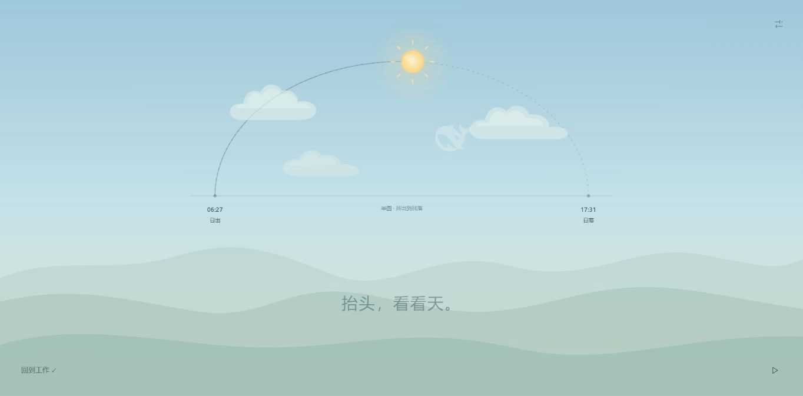
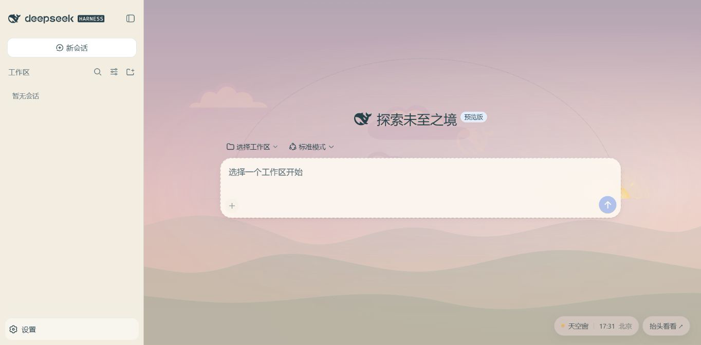

# DSH Sky Window

[简体中文](./README.md) · [English](./README.en.md)

> A living sky for people who spend their day working at a screen.


These four scenes were captured from DSH running with the same date and city. The collage retains the source resolution of each screenshot; open the image to see the full size.

Sky Window is a native theme plugin for DeepSeek Harness. It places the sun on a semicircular path based on the selected city's local time, then shifts the sky gradually from dawn to daylight, sunset, moonlight, and stars.

While you work, the sky stays quietly behind the workspace. When you need a short break, choose “Look up” to see it without the rest of the interface.

## A day in the sky


This recording uses the plugin's “Play a day” feature to show the sun's path and the changing sky. The GIF is a lightweight README preview; [watch the 1364 × 672 MP4](./docs/media/sky-from-morning-to-night.mp4) for the larger view.

## Experience

### A sky behind your work

The native sidebar, conversations, composer, and model controls remain available. A compact control in the lower right of the home screen shows the time and city and opens the sky. It disappears in conversations to keep model and usage details visible. A soft reading backdrop helps with long conversations.


### Look up for a moment

The immersive view reduces text and controls. The sun's path shows how far the day has progressed, clouds drift slowly, and the lower corners hold the entries for returning to work and playing through a day.



### Explore time

Drag the timeline or choose sunrise, noon, sunset, or night. The glass control bar adapts to the sky's colors and keeps “Back to now” easy to find.

### Keep a moment as your wallpaper

Pause on a time in the sky view, then return to work. That sky stays in place without a floating preview reminder. To restore the live sky, open “Look up” again and choose “Back to now.”



### Make the window yours

Choose a city, request browser location with a click, adjust sky intensity, pause cloud motion, or play through a day.


## Features

- Estimates sunrise, sunset, and sun position from the city, date, and local time zone.
- Moves the sun along a semicircle and changes sky colors continuously with solar altitude.
- Shows dawn and sunset colors, a crescent moon, and stars at night.
- Provides a timeline, date selection, four time presets, and day playback.
- Lets a paused preview become the workspace wallpaper.
- Adapts the glass controls to daylight, sunset, and night.
- Drifts clouds slowly and respects the system's reduced motion setting.
- Hides the official DeepSeek mark as a translucent, cloudlike Easter egg.
- Stores the city, sky intensity, and motion preferences only in the local browser.

## Start in this project

Requires Node.js 22 or later. For a first DSH installation, run `npm install --global @deepseek-ai/dsh@0.2.1-rc.2`. Existing DSH users can keep their current installation. From the complete repository's root:

```powershell
.\start-dsh-sky.ps1
```

The default address is `http://127.0.0.1:3081`. The launcher reads the local DSH version, builds the plugin, and uses an isolated development profile at `.runtime/dsh-home`. It does not restrict DSH to a specific version; see the verified versions below.

If the browser does not open automatically, use the full authenticated URL printed by DSH. Add `-Port 3085` if the port is occupied. Press Ctrl+C in the terminal to stop the service.

This runs the actual DSH service. Configure a model through DSH's native settings when you first use it. Sky Window does not read or migrate existing API keys, model settings, or conversation history.

On Windows, this local launcher sets DSH's workspace folder picker to its web browsing mode. Use the add button beside “Workspaces” in the sidebar to browse folders, create a folder, and open it as a workspace. This setting applies only to the project's development profile.

## Install into an existing profile

Download `dsh-sky-window-0.1.0.tgz` from the [v0.1.0 release page](https://github.com/nickfast2025/dsh-sky-window/releases/tag/v0.1.0) and install it from its download directory using DSH's official command; this example uses `web`:

```powershell
dsh plugin --profile web add .\dsh-sky-window-0.1.0.tgz
```

Restart that profile with your original launch command, then enable Sky Window in DSH settings. The release archive requires no source download or local build.

To pack from source instead, download and extract the complete repository, then open PowerShell at its root:

```powershell
cd .\dsh-sky-window
npm pack
dsh plugin --profile web add .\dsh-sky-window-0.1.0.tgz
dsh web
```

`npm pack` builds automatically. The plugin source uses Node built-in modules and needs no extra dependency installation. Run `dsh web` from the directory you want to use as your workspace. If that profile is already running, restart it after installation, then enable Sky Window in DSH settings. Disable any other background plugin in the same profile if its styles overlap.

When adding the plugin to an existing DSH installation, keep using your original launch command (including any custom port arguments), address, and port. Sky Window runs inside that DSH service; it does not start a separate server or require port `3081`.

To disable the sky temporarily, turn off Enable Sky Window in its settings; the previous theme is restored. To uninstall it:

```powershell
dsh plugin --profile web remove dsh-sky-window
```

Restart that profile afterward. These plugin commands use your current `DSH_HOME`; the repository launcher uses its own `.runtime/dsh-home`.

## Troubleshooting

- **The page asks for authentication:** reopen the full URL printed during this DSH launch. Do not include a sign-in URL containing its token in an issue.
- **PowerShell blocks the script:** a downloaded ZIP may carry a source marker. After reviewing the source, run `Unblock-File .\start-dsh-sky.ps1` on the root launcher and try again.
- **The composer asks you to choose a workspace:** use the add button beside Workspaces to select a folder. Configure a model separately in DSH's native settings.
- **Another theme covers the sky, or long conversations look wrong:** disable other background plugins in that profile first. Include your DSH version, operating system, and reproduction steps when reporting the problem.

## Use

1. Use the add button beside “Workspaces” to select a folder, or create one and open it.
2. On the home screen, open Sky Window settings from the lower right and choose a city.
3. Choose “Look up” to enter the immersive sky.
4. Use the timeline or four presets to explore the day.
5. Choose “Back to work” at a favorite moment to keep it as the wallpaper.
6. Reopen the sky and choose “Back to now” to resume the live sky.

## Implementation and limits

- For a new installation, we recommend **DSH 0.2.1-rc.2**. In an isolated installation and profile, the 0.1.0 release package passed official install and uninstall, sky preview and playback, paused wallpaper, live restoration, saved preferences, theme restoration on disable, and a real model conversation. Existing users of **DSH 0.1.1-rc.2** can continue using it. The [seven-version compatibility table](../README.en.md#compatibility) records the runs, adjustments, and remaining checks for other versions.
- The plugin does not declare a fixed DSH version. Successful installation alone does not prove that every feature will keep working if DSH interfaces change; the statements above describe only observed results.
- Uses the official `ctx.theme` and `ctx.slots` APIs for the theme, background, entry points, and settings panel.
- Registers day and night themes and overrides theme tokens; disabling Sky Window restores the previous theme.
- The semicircle represents local progress from sunrise to sunset. Astronomical times are estimates computed locally.
- The night view does not calculate the moon's path or fetch live weather.
- Browser location is requested only after the user chooses “Locate.”
- The conversation reading backdrop accounts for the container structures observed in those two versions. Future layout changes need another check.

## Build and test

```powershell
node build.mjs
npm test
npm pack
```

`build.mjs` bundles the source, vector sky, and solar calculations into `lib/client.js`. At runtime, there is no CDN, image download, or other network dependency. The DeepSeek cloud uses a local vector outline styled by scene color and transparency.
